<div align="center">

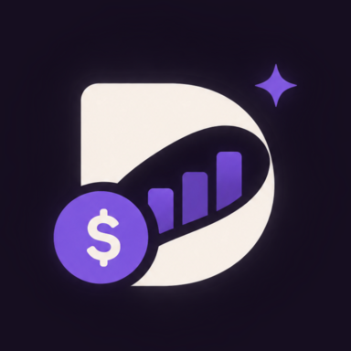

# Dreams

**Know your money. Fund your dreams.**

A private, offline-first money app for iPhone and android. Track what you own and owe, log every rupee
in seconds, close each month with a proper audit, and save toward the things you want.
Installed from Safari as a home-screen app (PWA), with optional sync to your own Supabase project.

`v1.1` · React 18 · TypeScript · Vite · IndexedDB · Supabase · iOS 16+

</div>

---

## Screenshots

<table>
  <tr>
    <td align="center">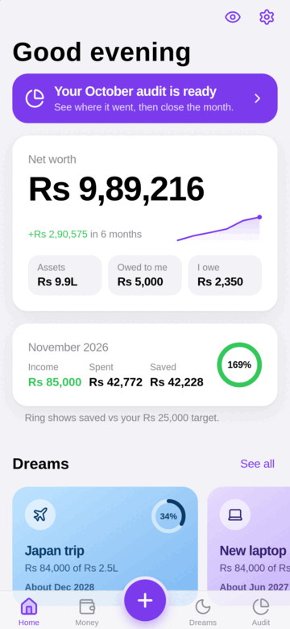<br /><sub><b>Home</b>: net worth, this month, dreams</sub></td>
    <td align="center">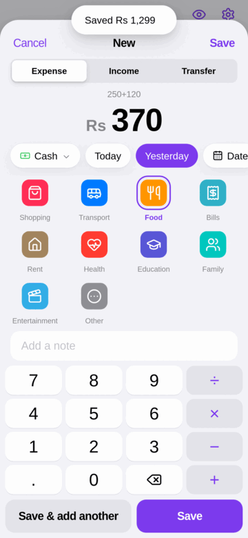<br /><sub><b>Add</b>: keypad with + − × ÷, 3 taps</sub></td>
    <td align="center">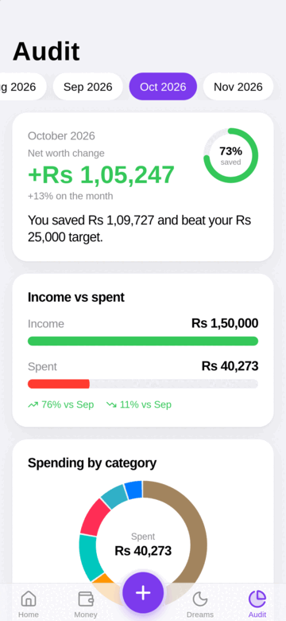<br /><sub><b>Audit</b>: where it went, what you saved</sub></td>
  </tr>
  <tr>
    <td align="center">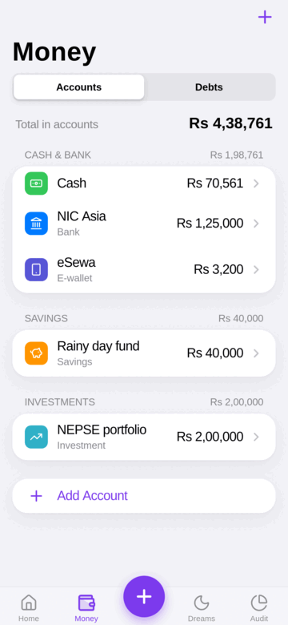<br /><sub><b>Accounts</b>: cash, bank, wallet, savings, investments</sub></td>
    <td align="center">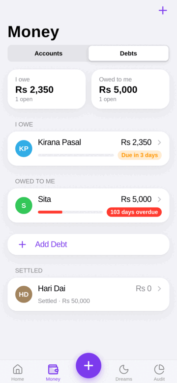<br /><sub><b>Debts</b>: I owe / owed to me, due dates</sub></td>
    <td align="center">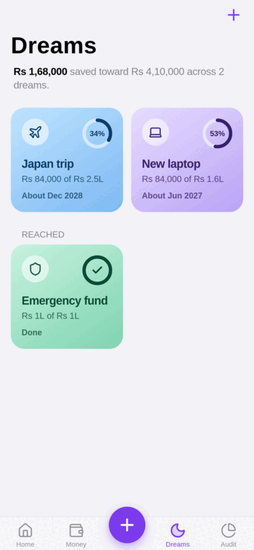<br /><sub><b>Dreams</b>: savings goals with ETA</sub></td>
  </tr>
  <tr>
    <td align="center">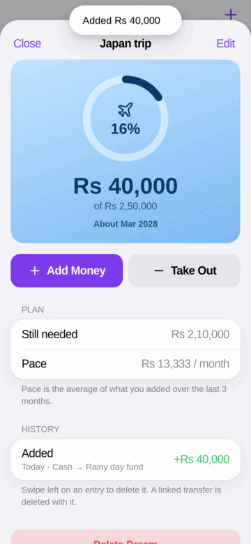<br /><sub><b>Dream detail</b>: pace, plan, history</sub></td>
    <td align="center">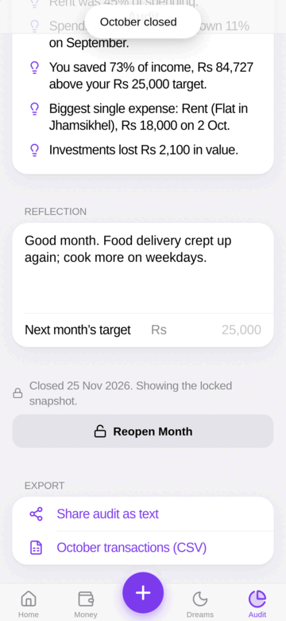<br /><sub><b>Close month</b>: reflection, locked snapshot</sub></td>
    <td align="center">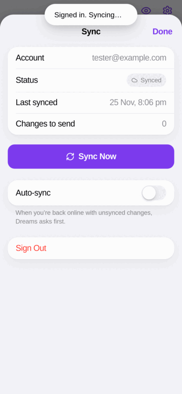<br /><sub><b>Sync</b>: your own Supabase, last write wins</sub></td>
  </tr>
  <tr>
    <td align="center">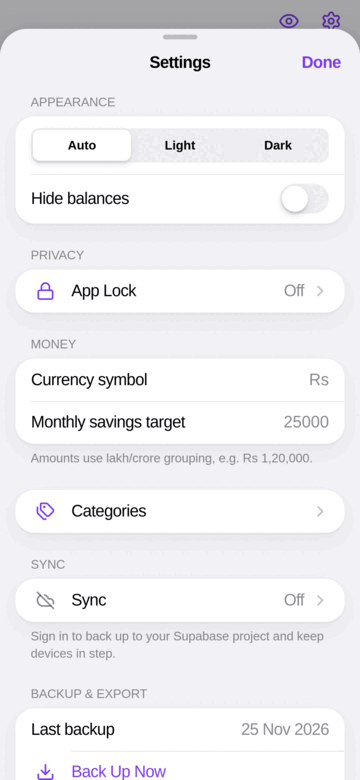<br /><sub><b>Settings</b>: lock, categories, backup</sub></td>
    <td align="center">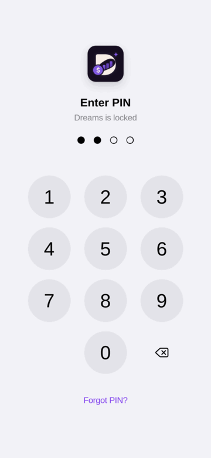<br /><sub><b>App lock</b>: PIN, privacy cover</sub></td>
    <td align="center">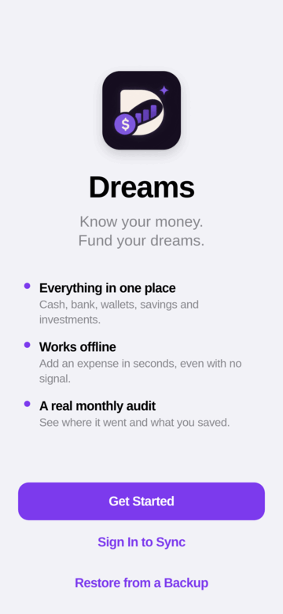<br /><sub><b>Welcome</b>: set up, sign in or restore</sub></td>
  </tr>
</table>

**Dark mode** follows the system (or pick Light / Dark in Settings):

<p align="center">
  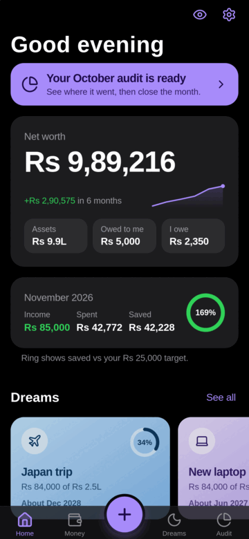
  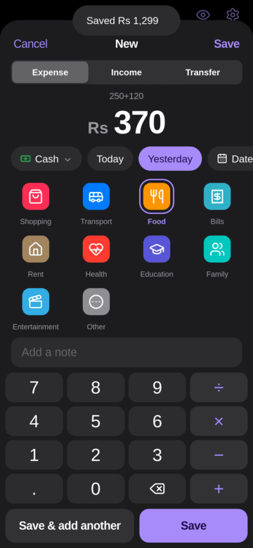
  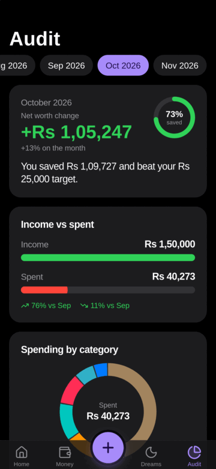
  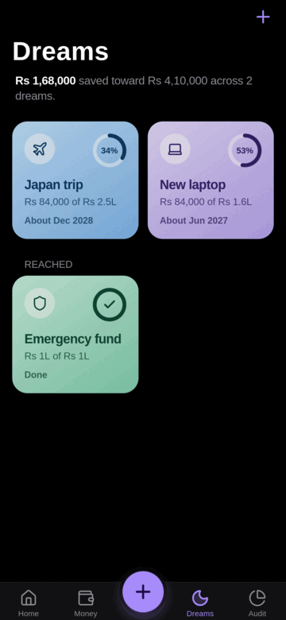
</p>

<p align="center">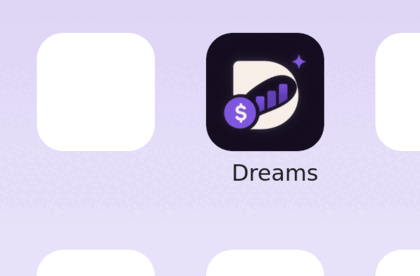<br /><sub>On the Home Screen</sub></p>

Screenshots are from the iPhone X layout (375×812) with made-up demo data.

---

## Features

**Money**
- Accounts of five kinds: cash, bank, e-wallet, savings, investment. Correct a balance or update an investment's value without faking income or spending.
- Expenses, income and transfers in **3 taps or fewer**, with a custom keypad that does sums (`250+120×2`), recent-first categories, and Today / Yesterday / any date.
- Edit by tapping, swipe left to delete, and **Undo** everything.
- Amounts in **NPR with lakh/crore grouping** (`Rs 1,20,000`). Every amount is stored as whole paisa, never as a float.

**Debts**
- What you **owe** and what you're **owed**, with progress bars, due dates, and red "overdue" / orange "due soon" badges.
- Optionally record the cash that changed hands. Borrowing Rs 50,000 with cash and repaying Rs 20,000 leaves Rs 30,000 owed, with net worth unchanged.

**Dreams (savings goals)**
- Targets with progress rings, an ETA from your last 3 months' pace, and the monthly amount needed to hit a date.
- "Also move money from an account" records a real transfer; otherwise money is just earmarked. Confetti when a dream is fully funded.

**Monthly audit**
- Net-worth change, savings rate, income vs spent, spending by category (donut and ranked bars, tap one to drill in), top 5 expenses, saved & invested, debts, and rule-based insights.
- A **net-worth walk that always reconciles**: start + income − spending ± investment gains ± corrections (+ "other" only when non-zero) = end.
- Write a reflection, set next month's target, and **Close month** to lock a snapshot. Home reminds you when last month is ready.

**Privacy and safety**
- Works **fully offline**; your data lives on the iPhone (IndexedDB).
- **App lock** with a 4–6 digit PIN (PBKDF2-hashed, never leaves the phone), auto-lock, and a privacy cover in the app switcher.
- **Hide balances** blurs every amount for use in public.
- **Backup / restore** as one JSON file, plus CSV and plain-text exports through the iOS share sheet.
- Optional **sync** to your own Supabase project (email + password, row-level security, no third-party trackers).

**Feel**
- Built to feel like a first-party iOS app: large-title navigation, inset grouped lists, bottom sheets with drag-to-dismiss, segmented controls, swipe actions, and a translucent tab bar.
- Light and dark themes, reduced motion respected, 44 pt touch targets, and a first load of about 193 KB gzipped.

---

## Install on your iPhone

Dreams is a web app you add to the Home Screen; no App Store needed.

1. Open the site (your Cloudflare Pages address, e.g. `https://dreams-xxx.pages.dev`) in **Safari**. Only Safari can install it.
2. Tap **Share** → **Add to Home Screen** → **Add**.
3. Open **Dreams from the Home Screen icon**, then set it up there.
   Safari and the installed app keep **separate storage** on iOS, so don't enter data in the Safari tab.
4. Choose one:
   - **Get Started**: add your first account and its current balance.
   - **Sign In to Sync**: on a second device, pull everything from your Supabase account.
   - **Restore from a Backup**: pick a Dreams `.json` backup from Files or iCloud Drive.

Updates install themselves: when a new version is deployed, Dreams shows **Update available · Reload**.

---

## Getting started (development)

**Requirements:** Node.js **22+** and npm. ImageMagick 7 is only needed to regenerate icons.

```bash
git clone git@github.com:MrRishabThapa/dreams.git
cd dreams
npm ci
cp .env.example .env.local      # optional: only needed for sync (see below)
npm run dev                     # http://localhost:5173  (design kit at /_kit)
```

Open it in Safari's Responsive Design Mode or Chrome's device toolbar at iPhone X size (375×812).
To fill the app with a realistic year of made-up data:

```bash
npm run demo                    # writes demo-backup.json (dev only, never shipped)
```

Then use **Restore from a Backup** on the welcome screen.

### Environment variables

Sync is optional. Without these, Dreams works fully offline and Settings → Sync says it isn't set up.

| Variable | Value |
|---|---|
| `VITE_SUPABASE_URL` | Your project URL, e.g. `https://your-project.supabase.co` |
| `VITE_SUPABASE_ANON_KEY` | The project's **publishable** key (`sb_publishable_…`) |

Both are public by design and ship in the app. **Never** use the secret / service-role key or the
database password. `.env.local` is gitignored. Hosted builds read the same names from the
build environment; each build logs `[dreams] sync configured: yes|no`.

---

## Deploy

Dreams is a static site (`dist/`) hosted on **Cloudflare Pages**. Full steps are in **[DEPLOY.md](DEPLOY.md)**.

**From this computer** (reads `.env.local`):

```bash
npx wrangler login     # once
npm run deploy         # build + upload to the Pages project "dreams"
```

**From GitHub** (auto-deploys on every push to `main`): connect the repo in Cloudflare → Pages, with
build command `npm run build`, output `dist`, and these **Text** build variables for Production and
Preview: `NODE_VERSION=22`, `VITE_SUPABASE_URL`, `VITE_SUPABASE_ANON_KEY`.

> Don't add a `wrangler.toml` to this repo. Cloudflare would use it instead of the dashboard
> variables, and the build would ship without sync.

`public/_headers` adds a strict Content-Security-Policy (only your Supabase origin may be contacted),
security headers, and cache rules.

---

## Sync (optional)

1. Create a Supabase project and run **[`supabase/schema.sql`](supabase/schema.sql)** in the SQL editor
   (eight tables, row-level security, and a trigger that ignores stale offline writes).
2. Authentication → add your one user, then **turn off public sign-ups**.
3. Put the URL and publishable key in `.env.local` (or the Pages build variables) and deploy.
4. In the app: **Settings → Sync** → email + password → **Sign In**. Everything uploads right away.

How it works: changes are saved locally first and marked as pending. A sync pushes them in batches,
then pulls newer rows from each table. If two devices edit the same thing, **the latest edit wins**,
and an older offline edit can never overwrite a newer one. Deletes sync too. Auto-sync is off by
default: when you come back online, Dreams asks **"You're online. Sync N changes?"**. Sign Out never
deletes local data.

---

## Scripts

| Command | What it does |
|---|---|
| `npm run dev` | Development server |
| `npm run build` | Typecheck + production build into `dist/` |
| `npm run preview` | Serve the production build on port 4173 |
| `npm test` | Unit tests (Vitest) |
| `npm run e2e` | End-to-end tests in WebKit with iPhone X emulation (Playwright) |
| `npm run deploy` | Build and upload to Cloudflare Pages |
| `npm run demo` | Write a dev-only demo year as `demo-backup.json` |
| `npm run icons` | Regenerate every icon and launch image from `public/logo.png` |

Screenshots for review: `SHOTS=1 npx playwright test e2e/screenshots.spec.ts e2e/screenshots-demo.spec.ts e2e/screenshots-sync.spec.ts`.

On **Arch Linux**, run `scripts/setup-webkit-arch.sh` once so Playwright's WebKit can start (no sudo).

---

## Testing

- **63 unit tests** (Vitest): money and date rules, balances, debts, dreams, the audit, backup/restore,
  app lock, sync against a fake server that behaves like the real schema (two devices, stale edits,
  a failed batch, deletes), a real build with environment variables, and a performance budget.
  A property test checks the net-worth reconciliation on 300 random ledgers. A full demo year must
  reconcile in every month, and closing then reopening each month must match its snapshot.
- **16 end-to-end flows** (Playwright WebKit, iPhone X): onboarding, 3-tap add, 20 transactions
  **offline**, debts, dreams, month close, backup → erase → restore, app lock, the category editor,
  the offline → online sync banner (mocked Supabase), and a two-theme reduced-motion tour that
  fails on any console error.

---

## Project structure

```
src/
  domain/      pure rules: ledger, debts, dreams, audit, money, dates (unit-tested)
  db/          Dexie database, the single write path (repo.ts), backup, sync bookkeeping
  sync/        Supabase sync: engine, supabase-js adapter (lazy-loaded), controller
  ui/          iOS-style components: sheets, lists, keypad, charts, lock, banners
  sheets/      forms and detail screens (add, accounts, debts, dreams, settings, sync…)
  screens/     tabs: Home, Money, Dreams, Audit; onboarding; /_kit design gallery
  lib/         app state, catalog, motion, app lock
e2e/           Playwright tests and screenshot specs
scripts/       icons, demo year, build env check, WebKit setup for Arch
supabase/      schema.sql
public/        logo, icons, launch images, _headers
docs/          README screenshots
```

---

## Data and privacy

- No analytics, ads, trackers, web fonts or CDNs. Everything the app needs is bundled.
- Your data stays on your iPhone unless you turn on sync, and then it goes only to **your** Supabase
  project, protected by row-level security with a single user and sign-ups disabled.
- The app-lock PIN is stored only as a salted hash on the device and is never backed up or synced.
- Keep a JSON backup now and then (Settings → Back Up Now); it doesn't depend on Supabase.

---

<div align="center"><sub>Dreams is a personal project by Rishab Thapa. All rights reserved.</sub></div>
